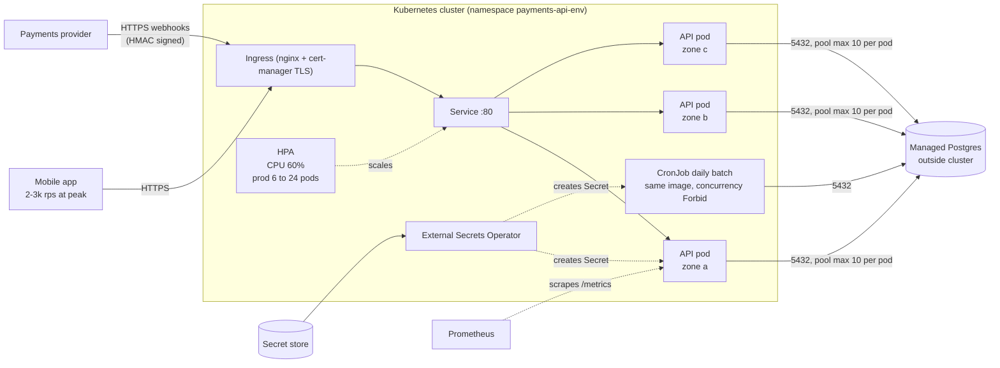
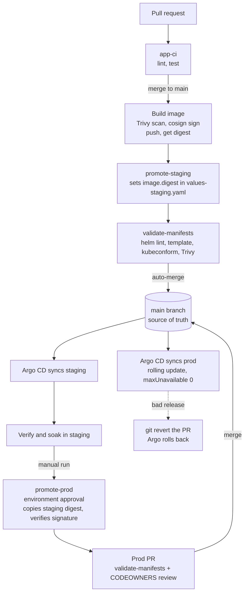
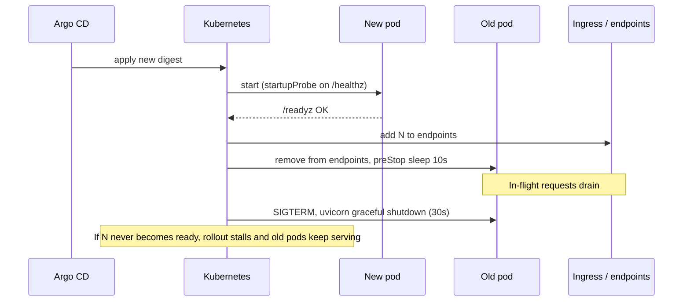

# payments-api-deploy

Kubernetes deployment for the payments-api (FastAPI on :8000, Postgres, payments webhooks, daily batch).
Helm chart, delivered by GitOps (Argo CD) from GitHub Actions. Start with [docs/DESIGN.md](docs/DESIGN.md).

## Runtime architecture



## Delivery flow



## What happens on a pod rollout



## Repository layout

```
app/                    Sample FastAPI service + batch job (stand-in for the real code)
tests/                  Smoke tests
Dockerfile
charts/payments-api/    Helm chart: Deployment, Service, Ingress, HPA, PDB, ConfigMap, ExternalSecret, CronJob, NetworkPolicy
                        values.yaml + values-staging.yaml + values-prod.yaml
argocd/                 Argo CD Applications (GitOps)
.github/workflows/      app-ci, validate-manifests, promote-staging, promote-prod
docs/DESIGN.md          Decisions, assumptions, open questions, what was left out   <- start here
docs/DELIVERY.md        Staging -> prod
docs/MONITORING.md      Health, 3am pages vs next-morning
```

## Try it locally

```sh
pip install -r requirements-dev.txt && pytest -q
helm lint charts/payments-api -f charts/payments-api/values-prod.yaml
helm template payments-api charts/payments-api -f charts/payments-api/values-prod.yaml
```

Placeholders to fill before use: image org (`example-org`), hostnames, secret paths, DB CIDR, Argo repo URL/cluster names, and the initial image digest in each values file.
