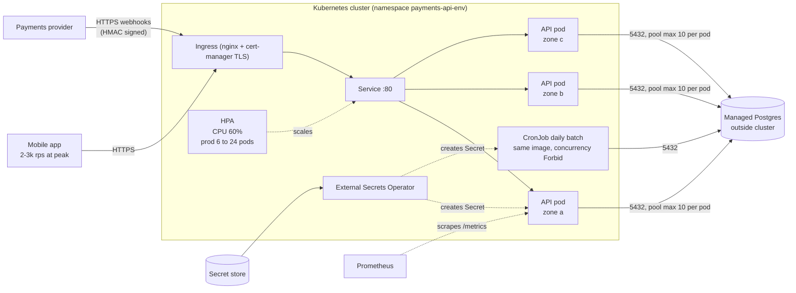
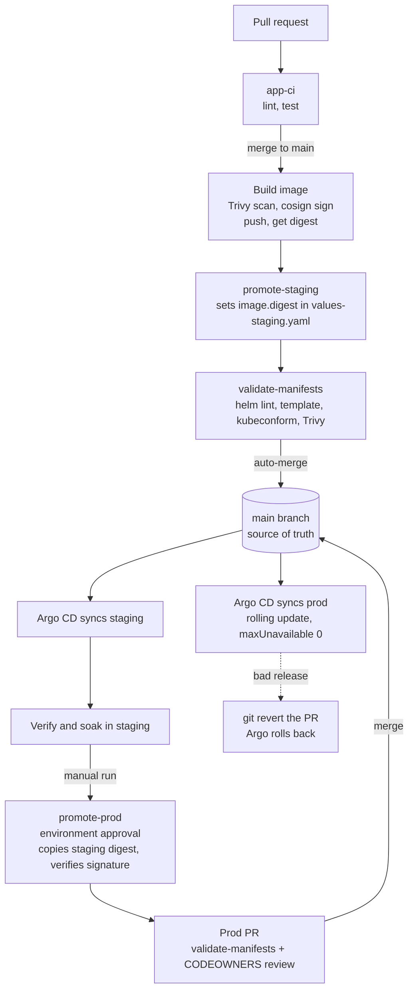
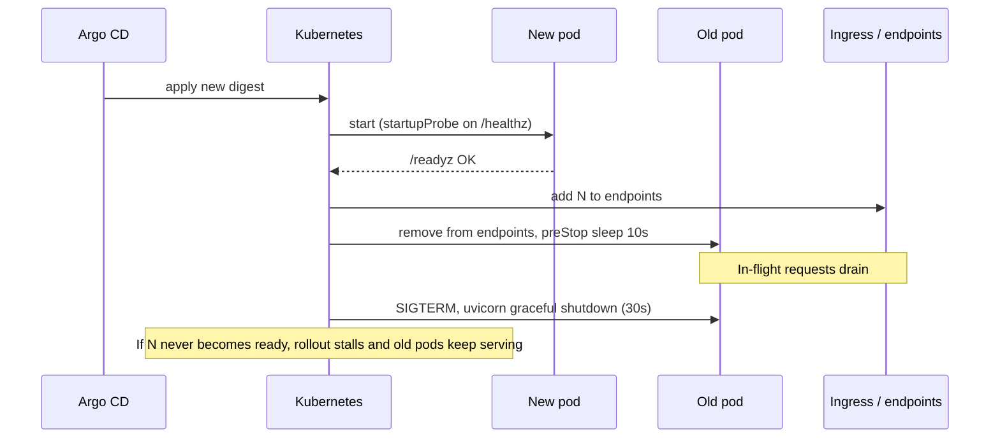

# payments-api-deploy

Kubernetes deployment for the payments-api (FastAPI on :8000, Postgres, payments webhooks, daily batch).
Helm chart, delivered by GitOps (Argo CD) from GitHub Actions. Start with [docs/DESIGN.md](docs/DESIGN.md).

## Runtime architecture



## Delivery flow



## What happens on a pod rollout



## Prerequisites

Nothing below is created by this repo. It must exist before the first deploy.

**Cluster (one each for staging and prod)**
- Kubernetes 1.27 or later (the CronJob `timeZone` field), spanning 3 availability zones.
- Ingress controller: ingress-nginx, installed in the `ingress-nginx` namespace.
- cert-manager, with a ClusterIssuer named `letsencrypt`.
- External Secrets Operator, with a ClusterSecretStore named `platform-secrets`.
- Argo CD, with both clusters registered as destinations (`staging-cluster`, `prod-cluster`).
- Prometheus (Operator or compatible) in the `monitoring` namespace, able to scrape pod annotations.
- A CNI that enforces NetworkPolicy, and a metrics-server for the HPA.

**Secret store**
- One entry per environment (`staging/payments-api`, `prod/payments-api`) with two keys: `database_url` and `webhook_secret`.

**Database**
- Postgres already provisioned and reachable from the cluster on port 5432. It needs the `orders` and `webhook_events` tables (unique constraint on `event_id`), which this repo does not create or migrate.
- Network range of the database set in `networkPolicy.dbCidr`.

**GitHub**
- Container registry access to `ghcr.io/<org>/payments-api`, with Actions allowed to push packages.
- Branch protection on `main` with required checks `app-ci` and `validate-manifests`.
- "Allow auto-merge" enabled, and Actions allowed to create pull requests.
- A `production` environment with required reviewers.
- CODEOWNERS covering `charts/payments-api/values-prod.yaml`.

**Local tools (to render and test)**
- Python 3.12, Helm 3.16 or later, and optionally kubectl.

## Assumptions

These are guesses I made to keep within the time box. Docs cover them in more detail ([docs/DESIGN.md](docs/DESIGN.md)).

**About the service**
- The real image has the same contract as the sample in `app/`: uvicorn as UID 10001 on port 8000, `/healthz`, `/readyz` and `/metrics` endpoints, and a batch entry point `python -m app.batch`.
- The app is stateless, and one process per pod is the right unit of scaling.
- The batch job is idempotent and safe to retry. Webhook handling is idempotent on the provider's event ID.
- The API makes no outbound calls other than to Postgres. If it needs more, the NetworkPolicy egress rules need widening.

**About load and capacity**
- One pod handles roughly 150 to 250 rps. This is **unmeasured**, so replica bounds (prod 6 to 24, staging 2 to 4), CPU and memory requests, and the 60% HPA target are placeholders until a load test.
- Overnight traffic is about a tenth of peak, and the evening ramp is fast and predictable.
- Each pod uses up to 10 database connections. The prod ceiling is 24 pods x 10 = 240, and I assume the database can accept that. **Unconfirmed.**

**About operations**
- Staging and prod are separate clusters, with a single region.
- The batch runs daily at 04:00 UTC, assumed to be a quiet window.
- Hostnames, secret paths, DB CIDR (`10.0.0.0/16`), image org (`example-org`), Argo repo URL and cluster names are placeholders.
- The payments provider needs a public HTTPS endpoint and cannot be restricted by IP.
- Database migrations are backward compatible with the previous app version, so a rollback is safe.
- Nobody has defined an SLO yet. Alert thresholds in [docs/MONITORING.md](docs/MONITORING.md) are strawmen.

**Not verified here**
- The chart has not been rendered with Helm, the workflows have not run, and nothing was applied to a cluster.

## Repository layout

```text
app/                    Sample FastAPI service + batch job (stand-in for the real code)
tests/                  Smoke tests
Dockerfile
charts/payments-api/    Helm chart: Deployment, Service, Ingress, HPA, PDB, ConfigMap, ExternalSecret, CronJob, NetworkPolicy
                        values.yaml + values-staging.yaml + values-prod.yaml
argocd/                 Argo CD Applications (GitOps)
.github/workflows/      app-ci, validate-manifests, promote-staging, promote-prod
docs/DESIGN.md          Decisions, assumptions, open questions, what was left out   <- start here
docs/DELIVERY.md        Staging -> prod
docs/MONITORING.md      Health, 3am pages vs next-morning
```

## Try it locally

```sh
pip install -r requirements-dev.txt && pytest -q
helm lint charts/payments-api -f charts/payments-api/values-prod.yaml
helm template payments-api charts/payments-api -f charts/payments-api/values-prod.yaml
```

Placeholders to fill before use: image org (`example-org`), hostnames, secret paths, DB CIDR, Argo repo URL/cluster names, and the initial image digest in each values file.

## First deploy checklist

1. Confirm every prerequisite above.
2. Replace the placeholders, and run `helm lint` and `helm template` for both environments.
3. Build and push the image, then set `image.digest` in `values-staging.yaml`.
4. Apply `argocd/applications.yaml` to each cluster's Argo CD.
5. Load test staging and set resource requests and replica bounds from the results.
6. Get answers to the open questions in [docs/DESIGN.md](docs/DESIGN.md), especially the database connection budget, before promoting to prod.
